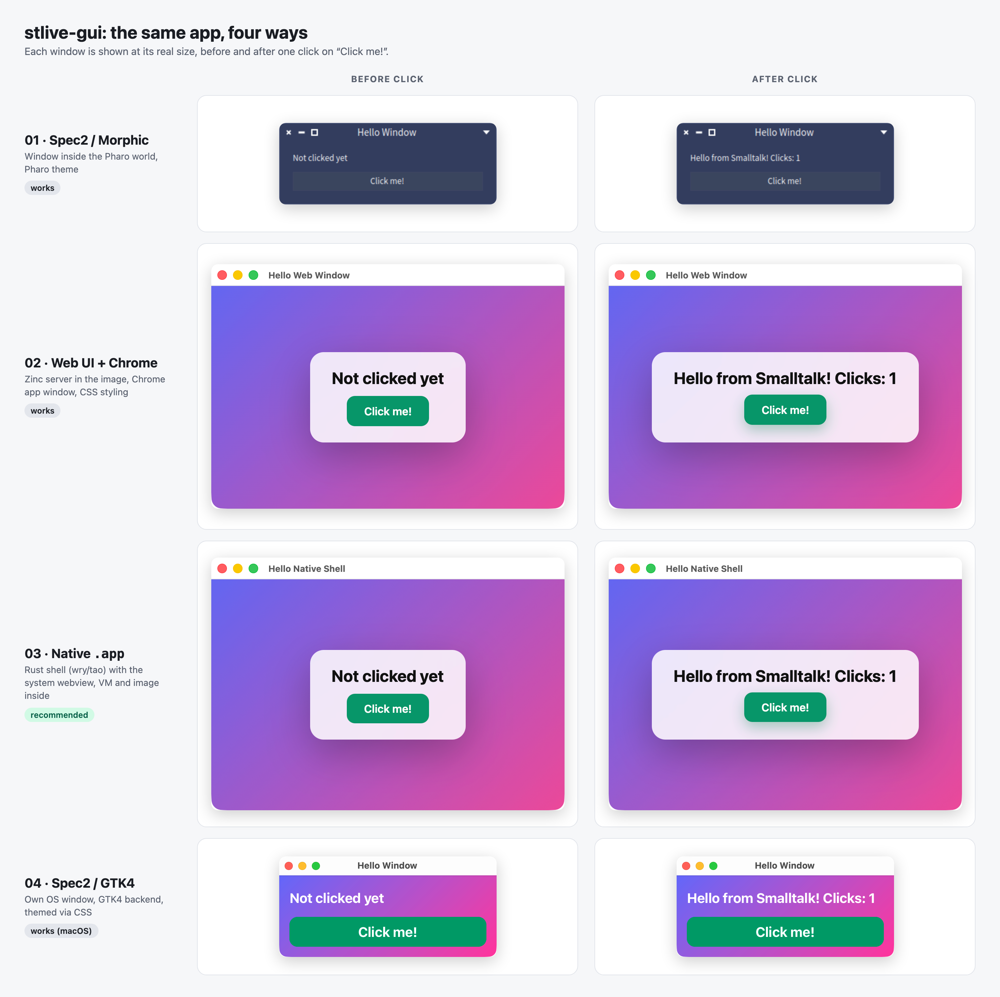
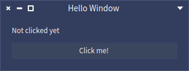
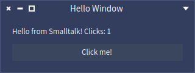
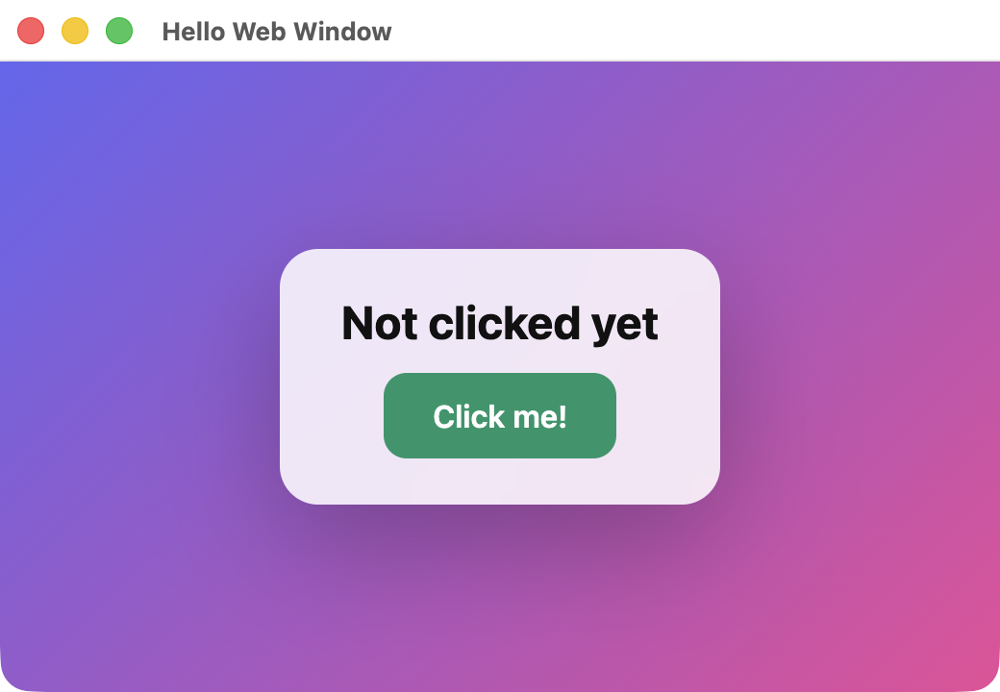
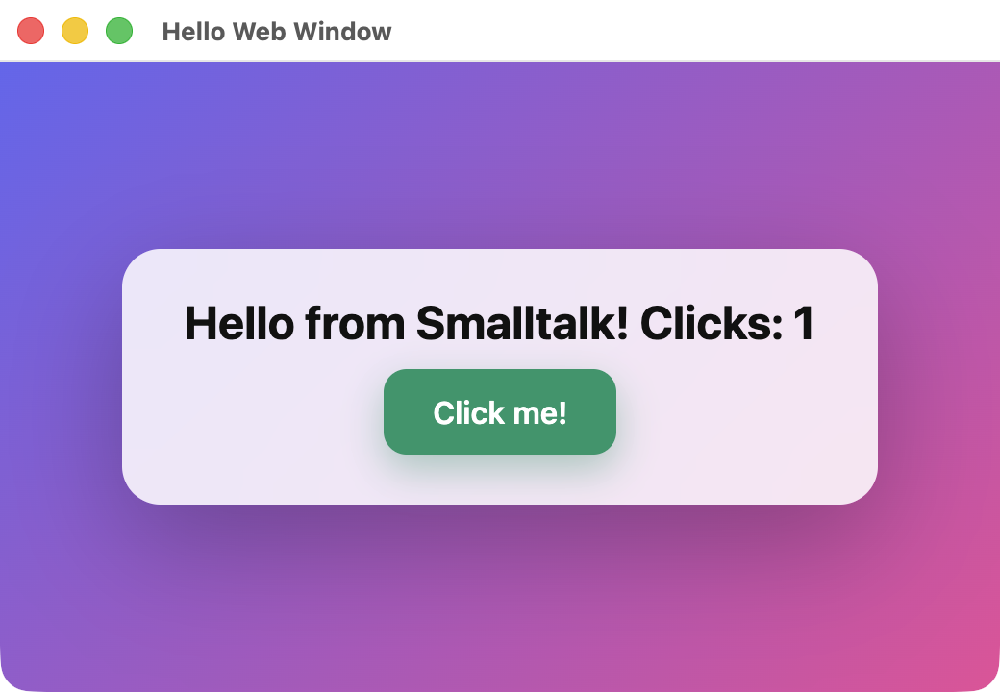
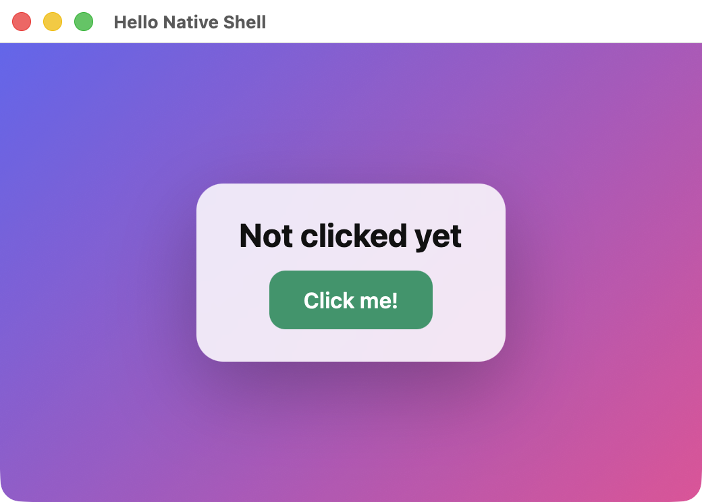
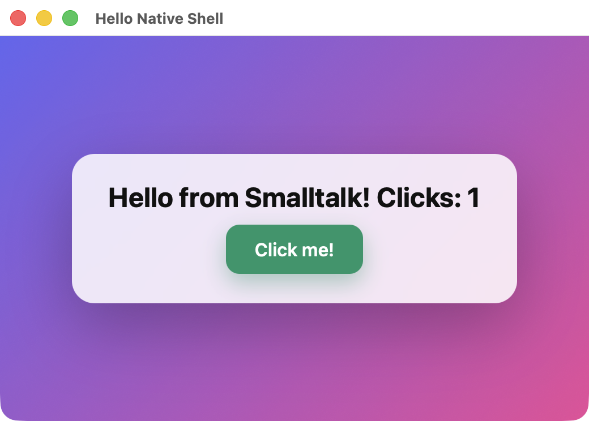

# stlive-gui: four ways to ship a Pharo app with a window

This repo shows how to build a small desktop app (a window with a label and a button) from Pharo/Smalltalk, and which route to choose for an app you can actually ship and that looks good. It also shows what you can do with `stlive`. Everything was built in a single session with an AI assistant (Claude Code), the `stlive` skill and the [`stlive` CLI](https://github.com/paulwilke/smalltalk-live-cli). The demo is deliberately tiny: a label, a button, a counter.

Tested on **macOS (Apple Silicon)** only. Windows has not been tried. All UI texts are in English.

## The four ways at a glance

| # | Way | Window | Look | Shipping | Result |
|---|---|---|---|---|---|
| 01 | Spec2 inside the Pharo world | window inside the Pharo UI | Pharo theme | the user sees Pharo | works |
| 02 | Zinc web server in the image + Chrome `--app` | own OS window | free (CSS) | user needs Chrome/Edge | works, **developed live with stlive** |
| 03 | Web server + own Rust shell (wry/tao) using the system webview | own OS window, a single `.app` | free (CSS) | **`HelloShell.app`, 143 MB, nothing to install** | works, **recommended** |
| 04 | Spec2 with the GTK4 backend | own OS window | GTK4, themable via CSS | hard, GTK dylibs required | works on macOS; Windows currently not supported by Spec-Gtk |

### Before and after one click

All four ways run the same tiny app. Each window is shown at its real size, before and after one click on "Click me!":



| | Before click | After click |
|---|---|---|
| **01** Spec2 / Morphic |  |  |
| **02** Web UI + Chrome app window |  |  |
| **03** Native `.app` (system webview) |  |  |
| **04** Spec2 / GTK4 (CSS-themed) |  |  |

How they were captured: 01 with `stlive` 0.5.0 itself (`start --gui`, `eval --ui`, `ui press`, `ui screenshot`); 02 and 03 with the macOS window capture of the real windows after a real click; 04 with the window capture after the click action was triggered inside the image (`button click`), because the GTK window is not driven by `stlive`. The window in 04 is a separate Pharo 14 process.

## How we got there with `stlive`

`stlive` is a CLI that lets an assistant (or you) evaluate code in a running Pharo image, change methods, inspect failures and save the result as Tonel files. The flow used here:

1. **Setup**: `stlive init` downloads Pharo 13 and builds an image with the server (5 seconds here). `stlive start` starts it headless.
2. **Create the class and write methods** instead of typing files:
   ```bash
   stlive class create HelloPresenter --superclass SpPresenter --ivars 'label button count' --package HelloWindow
   stlive method compile HelloPresenter --protocol actions - <<'EOF'
   click
       count := count + 1.
       label label: 'Hello from Smalltalk! Clicks: ', count printString
   EOF
   ```
3. **Try it immediately** with `stlive eval` (the counter logic was checked without a window: two clicks give 2).
4. **Save**: `stlive save --package HelloWindow --dir src` writes Tonel files that belong in the repo.
5. **Change live**: for ways 02 and 03 the image keeps running in the background and `stlive` stays connected. A change to the page (`WebHello>>page`) via `eval`/`compile` shows up in the open window after a reload.
6. **Show it in a window**: the stlive image is headless and has no window. For ways 01 and 04 a second Pharo with a GUI was started, which loads the saved Tonel files (`run.st`, `start.sh`).

## Pitfalls

- **`stlive start` is headless.** Ways 01 and 04 need a second Pharo with a window. `stlive` 0.4.0+ adds `start --gui` and `ui screenshot/press` for this. Way 01 was re-checked with 0.5.0: the window opens, `ui press` clicks the button and `ui screenshot` captures the result. These commands only understand Morphic, so they do not drive way 04 (GTK).
- **Spec-Gtk needs** GTK **4** (not 3), gtksourceview5, **Pharo 14** with the matching VM, and must be started with `--worker --headless`. An image that had been run once was broken afterwards, so `04-spec-gtk/start.sh` always copies a fresh `base.image`. On Windows Spec-Gtk does not currently work according to its README.
- **The `.app`** is unsigned; the first start took about 20 seconds. On other Macs Gatekeeper will probably ask (not checked).

## Tested version

- `stlive` from [paulwilke/smalltalk-live-cli](https://github.com/paulwilke/smalltalk-live-cli), **0.5.0** (built from the working tree, newer than commit `2c34e4e`). Used here: `start`, `start --gui`, `load`, `eval`, `eval --ui`, `method compile`, `ui windows`, `ui screenshot`, `ui press`, `open-ui`, `stop`. The first versions of the demos were built with a binary that still reported itself as 0.3.1.
- Pharo 13 (ways 01-03), Pharo 14 (way 04), macOS on Apple Silicon.

## Try it yourself

Requirements: macOS, [`stlive`](https://github.com/paulwilke/smalltalk-live-cli) (run `stlive init` once; it downloads Pharo 13 into `~/.stlive`), a Rust toolchain for 03, and `brew install gtk4 gtksourceview5` for 04.

```bash
# 01 Spec2 in Morphic
cd 01-spec-morphic && ./start.sh

# 02 web window with stlive
cd 02-web-window
stlive start && stlive load WebHello --repository tonel://$PWD/src
stlive eval 'WebHello start: 8765' && ./open-window.sh

# 03 build your own .app (VM + image built in), then: open dist/HelloShell.app
cd 03-webview-shell && ./build-app.sh

# 04 Spec2 + GTK4
cd 04-spec-gtk && ./setup.sh && ./start.sh
```

## More

- [04-spec-gtk/NOTES.md](04-spec-gtk/NOTES.md): details and pitfalls for Spec-Gtk.

## Licenses and third-party software

Own code: MIT (see `LICENSE`). Third-party software is **not included in this repository**; it is downloaded when you build or run: Pharo and its VM (MIT), Spec-Gtk (no license file found upstream, so check before redistributing), the Rust crates `wry` and `tao` (Apache-2.0 / MIT), GTK4 and gtksourceview5 (LGPL, installed via Homebrew). See [THIRD-PARTY.md](THIRD-PARTY.md). If you distribute the `.app` or a GTK bundle, you must follow the license terms of what it contains.

## Recommendation

For a local app that looks good and can be shipped: **way 03**. UI in HTML/CSS, logic in Smalltalk, developed with `stlive` in the headless image, shipped as a single `.app`.
