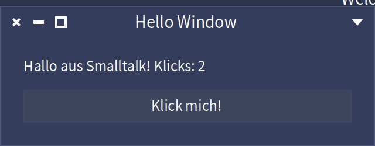
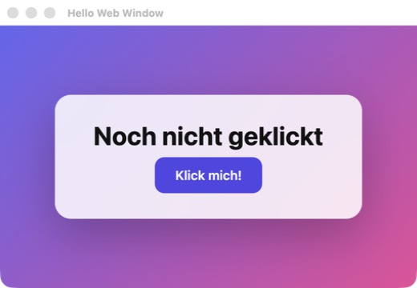
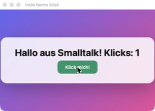
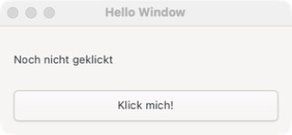
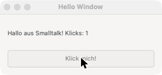

# stlive-gui: vier Wege, eine Pharo-App mit Fenster auszuliefern

Dieses Repo zeigt, wie man aus Pharo/Smalltalk heraus eine kleine Desktop-App mit Fenster und Knopf baut, und welchen Weg man für eine auslieferbare, gut aussehende App wählen sollte. Es zeigt zugleich, was man mit `stlive` anstellen kann. Entstanden ist alles in einer einzigen Sitzung mit einem KI-Assistenten (Claude Code), dem [`stlive`-Skill](https://github.com/paulwilke/smalltalk-live-cli) und der `stlive`-CLI. Die Demo ist absichtlich klein: ein Label, ein Knopf, ein Zähler.

Getestet nur auf **macOS (Apple Silicon)**. Windows ist nicht geprüft.

## Die vier Wege auf einen Blick

| # | Weg | Fenster | Optik | Auslieferung | Ergebnis |
|---|---|---|---|---|---|
| 01 | Spec2 in der Pharo-Welt | Fenster in der Pharo-Oberfläche | Pharo-Theme | Kunde sieht Pharo | läuft |
| 02 | Zinc-Webserver im Image + Chrome `--app` | eigenes OS-Fenster | frei per CSS | Kunde braucht Chrome/Edge | läuft, **mit stlive live entwickelt** |
| 03 | Webserver + eigene Rust-Hülle (wry/tao) mit System-Webview | eigenes OS-Fenster, eine `.app` | frei per CSS | **`HelloShell.app`, 143 MB, nichts zu installieren** | läuft, **Empfehlung** |
| 04 | Spec2 mit GTK4-Backend | eigenes OS-Fenster | GTK4, per CSS themebar | schwierig, GTK-dylibs nötig | läuft auf dem Mac, Windows laut Spec-Gtk derzeit nicht |

### Screenshots

| 01 Spec2/Morphic | 02 Web im Chrome-App-Fenster | 03 Eigene `.app` |
|---|---|---|
|  |  |  |

| 04 Spec2/GTK4 (Standard) | 04 nach Klick | 04 mit CSS-Theming |
|---|---|---|
|  |  |  |

In 02 und 03 ist der Knopf grün, weil seine Farbe zur Laufzeit über `stlive` geändert wurde, während das Fenster offen war.

## Der Weg dorthin mit `stlive`

`stlive` ist eine CLI, mit der ein Assistent (oder man selbst) in einem laufenden Pharo-Image Code auswertet, Methoden ändert, Fehler untersucht und das Ergebnis als Tonel-Dateien speichert. Der Ablauf hier:

1. **Setup**: `stlive init` lädt Pharo 13 und baut ein Image mit dem Server (hier 5 Sekunden). `stlive start` startet es headless.
2. **Klasse anlegen und Methoden schreiben** statt Code in Dateien zu tippen:
   ```bash
   stlive class create HelloPresenter --superclass SpPresenter --ivars 'label button count' --package HelloWindow
   stlive method compile HelloPresenter --protocol actions - <<'EOF'
   click
       count := count + 1.
       label label: 'Hallo aus Smalltalk! Klicks: ', count printString
   EOF
   ```
3. **Sofort ausprobieren** mit `stlive eval` (Zähllogik ohne Fenster geprüft: zwei Klicks ergeben 2).
4. **Speichern**: `stlive save --package HelloWindow --dir src` schreibt Tonel-Dateien, die dann ins Repo gehören.
5. **Live ändern**: Beim Weg 02 und 03 läuft das Image im Hintergrund, `stlive` ist verbunden. Eine Änderung an der Seite (`WebHello>>page`) per `eval`/`compile` wirkt nach dem Neuladen im offenen Fenster.
6. **Als Fenster zeigen**: Das stlive-Image ist headless und hat kein Fenster. Für Weg 01 und 04 wurde deshalb ein zweites Pharo mit GUI gestartet, das die gespeicherten Tonel-Dateien lädt (`run.st`, `start.sh`).

## Stolpersteine

- **`stlive start` ist headless.** Für Weg 01 und 04 braucht es ein zweites Pharo mit Fenster. `stlive` 0.4.0 bringt dafür `start --gui` und `ui screenshot/press`; das wurde hier nicht mehr durchgetestet (siehe Version unten).
- **Spec-Gtk braucht** GTK **4** (nicht 3), gtksourceview5, **Pharo 14** mit passender VM und den Start `--worker --headless`. Ein einmal benutztes Image war danach kaputt, deshalb kopiert `04-spec-gtk/start.sh` immer frisch von `base.image`. Unter Windows läuft Spec-Gtk laut seiner README derzeit nicht.
- **Die `.app`** ist unsigniert, der erste Start dauerte ca. 20 Sekunden. Auf anderen Macs fragt Gatekeeper vermutlich nach (nicht geprüft).

## Getestete Version

- `stlive` aus [paulwilke/smalltalk-live-cli](https://github.com/paulwilke/smalltalk-live-cli), Stand **0.4.0** (Commit `2c34e4e`). Die Demos selbst entstanden mit einem Binary, das sich noch als 0.3.1 meldete (headless, `init`, `start`, `eval`, `class create`, `method compile`, `save`). Die GUI-Funktionen von 0.4.0 sind nicht Teil dieser Demos.
- Pharo 13 (Weg 01–03), Pharo 14 (Weg 04), macOS auf Apple Silicon.

## Selbst ausprobieren

Voraussetzung: macOS, [`stlive`](https://github.com/paulwilke/smalltalk-live-cli) (`stlive init` einmal, lädt Pharo 13 nach `~/.stlive`), für 03 eine Rust-Toolchain, für 04 `brew install gtk4 gtksourceview5`.

```bash
# 01 Spec2 in Morphic
cd 01-spec-morphic && ./start.sh

# 02 Web-Fenster mit stlive
cd 02-web-window
stlive start && stlive load WebHello --repository tonel://$PWD/src
stlive eval 'WebHello start: 8765' && ./open-window.sh

# 03 eigene .app bauen (VM + Image eingebaut), danach: open dist/HelloShell.app
cd 03-webview-shell && ./build-app.sh

# 04 Spec2 + GTK4
cd 04-spec-gtk && ./setup.sh && ./start.sh
```

## Weitere Dokumente
- [04-spec-gtk/NOTES.md](04-spec-gtk/NOTES.md): Details und Stolpersteine zu Spec-Gtk.

## Lizenzen

Eigener Code: MIT (siehe `LICENSE`). Abhängigkeiten werden nicht mitgeliefert, sondern beim Bauen geladen: Pharo (MIT), Spec-Gtk (MIT), Rust-Crates `wry`/`tao` (MIT/Apache-2.0), GTK4 und gtksourceview5 (LGPL, von Homebrew installiert). Wer die `.app` oder ein GTK-Paket weitergibt, muss deren Lizenzbedingungen beachten.

## Empfehlung
Für eine lokale, gut aussehende, ausgelieferte App: **Weg 03**. Oberfläche in HTML/CSS, Logik in Smalltalk, entwickelt mit `stlive` im headless Image, ausgeliefert als eine `.app`.
